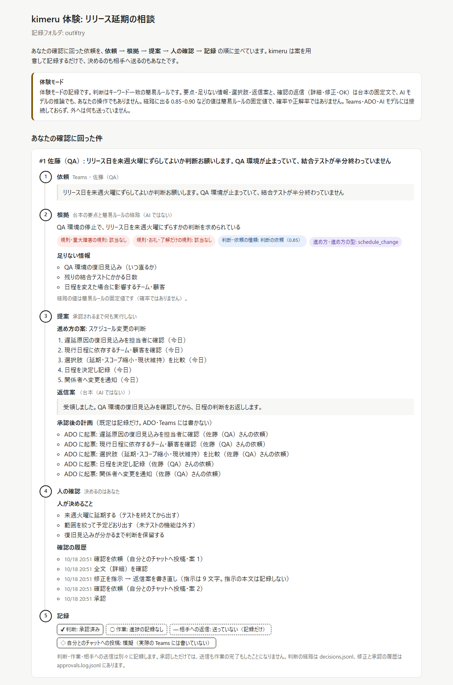

# kimeru

**届いた依頼から、対応手順と返信案を用意する。判断と送信は、あなたが確認してから。**

Windows と Teams で働く PM・開発リーダー向けの業務整理ツールです。Teams、Azure DevOps（ADO）、監視アラート、議事録の依頼を整理し、承認と作業の進捗を別々に記録します。

Python 3.10 以上 · 追加の Python 実行時パッケージ不要 · 業務での有効性を検証中

[できること](#できること) · [まず動かす](#まず動かす) · [画面と記録](#画面と記録) · [業務で使う準備](#業務で使う準備) · [毎日の使い方](#毎日の使い方) · [しくみとデータ](#しくみとデータ) · [検証と制約](#検証と制約) · [資料](#ドキュメント)

## できること

| 届くもの | kimeru が用意するもの |
|---|---|
| 「QA 環境が止まった。リリース日を変えてよい？」という Teams の相談 | 復旧見込みの確認 → 影響の確認 → 選択肢の比較、という対応手順と返信案 |
| 「決済 API のエラーが増え、顧客が支払えない」というアラート | 重大事象のチェック、障害対応の手順、連絡・起票の計画 |
| 情報不足の ADO 作業項目 | 不足情報の確認案。登録済み案件と本人の回答から要件案を保存することも可能 |
| 担当・期限のない会議後の宿題 | 決定・タスク・リスクの仕分け、決めきれない内容の確認待ち |

**文章生成 AI（writer）を設定すると、相談の文面から不足情報・選択肢・返信案を書きます。** 未設定なら、進め方の案と定型の返信文を使います。既定の判断はキーワードによる簡易判定で、実モデルは別途接続します。

相手への返信や起票は、既定では計画の記録だけです。承認済みの返信案は本人がコピーして相手へ送ります。外部への実行を有効にする場合も、種類ごとの設定と確認が必要です。

<a id="-まず動かす"></a>

## まず動かす

**Python 3.10 以上があれば、外部サービスにつながずに 1 件の流れを体験できます。** 追加のパッケージ、アカウント、API キー、Teams、ADO は不要です。

```powershell
git clone https://github.com/awano27/pm-decision.git kimeru
cd kimeru
python -m kimeru try
```

Git がない場合は [リポジトリ](https://github.com/awano27/pm-decision) の **Code → Download ZIP** で取得して展開し、`README.md` と `kimeru` フォルダが並ぶ場所で PowerShell を開いて `python -m kimeru try` を実行します。

「相談が届く → 情報と案を見る → 修正 → 承認 → 記録を見る」を順に表示します。最後に案内される **`out/try/report.html`** をブラウザで開いてください。

> `try` は個人設定・API キーを使わず、AI モデル・外部 CLI・Teams・ADO に接続しません。判断は簡易ルール、文章と本人の返信は固定の台本です。警告の検査、修正・承認の記録には実際の処理を使います。AI の精度や本番での承認を示す体験ではありません。

<details>
<summary>Python がない場合・別の起動方法・体験の隔離</summary>

- `python --version` で 3.10 以上と出ることを確認します。Python がない Windows PC では [Python の配布元](https://www.python.org/downloads/) から準備し、PowerShell を開き直してください。会社 PC への導入は [管理された PC での導入](docs/managed-environments.md) を参照してください。
- Windows の `try.cmd` も同じ体験の入口です。完了後にレポートを開く作りですが、ダブルクリック自体は未確認で、中身を PowerShell から実行して確認しています。ほかの `.cmd` は実機確認やモデル準備用で、Teams 操作・送信・サインインを含む場合があります。
- `pip install git+https://github.com/awano27/pm-decision` または `uv tool install git+https://github.com/awano27/pm-decision` で入れた場合は `kimeru try` で動きます。判断グラフや台本などの必要ファイルも同梱されます。
- `try` は処理中の Python のネットワーク接続と子プロセス起動を遮断し、`out/try` と終了時に消す一時フォルダだけに書き込みます。既存の設定と通常の記録は使いません（[隔離の設計](docs/design.md#7-体験モードpython--m-kimeru-tryの隔離)）。
- Windows では体験の確認記録があり、Linux は CI の試験対象です。macOS と初めての利用者による所要時間は未確認です（[体験の検証記録](docs/try-verification.md)）。

</details>

## 画面と記録

`python -m kimeru try` が生成したレポートです。架空のリリース延期相談について、**依頼 → 根拠 → 提案 → 人の確認 → 記録**を追えます。

<p align="center"></p>

**承認、作業完了、相手への送信、自分とのチャットへの投稿は別々に表示します。** 承認しただけで、送信済みや作業完了にはなりません。[完成例の HTML](docs/sample/try-report.html) は Raw から保存してブラウザで開けます。[スマホ幅の画像](assets/readme/try-report-mobile.png) もあります。

<details>
<summary>自分とのチャットに届く投稿の例</summary>

自分とのチャットには、次の短い投稿として届きます（`try` の出力から抜粋。体験内では模擬投稿です）。

```text
[kimeru #1] 佐藤（QA）さん: リリース日を来週火曜にずらしてよいか判断お願いします。QA…
→ 佐藤さんに QA 環境の復旧見込みを聞く
案: 受領しました。QA 環境の復旧見込みを確認し、本日 15 時までに日程の判断をお返しします。
⚠ 元の材料に無い日付・数値あり（詳細 1）
OK 1 / NG 1 / 修正 1 <点> / 詳細 1
```

⚠ は、相談の文面にない「15 時」を返信案が約束しているためです。体験では `修正 1 時刻は約束せず短く` と返して書き直させ、`OK 1` で承認します。判断経路の 0.85 などの値は体験用の固定値で、正解の確率ではありません。

</details>

<details>
<summary>4 種類の入力を試す：PM の 1 日デモ（9 件）</summary>

Teams・アラート・ADO・議事録の 9 件を処理します。**`demo` は `try` と違い、この PC の writer 設定を使います。** 設定済みなら材料をその送り先へ送ることがあるため、外部へ送らず試したい場合は `try` を使ってください。

```powershell
python -m kimeru --backend stub --out out/demo demo --pace 0
```

デモ内の Teams は模擬で、実際の Teams や ADO には書き込みません。出力先は空である必要があります。繰り返すときは `out/demo-2` など新しい `--out` を指定してください。`--fresh` は既知の記録ファイルを `before-demo-<日時>` へ退避します。

`demo` の最後に、こう出ます。

```text
=== まとめ
    判断 9 件: 自動で決定 8 / 確信が低く安全側で決定 0 / 人の確認 1
    うち規則（安全網）で即決定 3 件、モデルの判断 17 回・合計 0.0 秒
    記録: out\demo\decisions.jsonl
    レポート: out\demo\report.html
```

件数は同梱台本の結果で、業務での精度ではありません。結果は `out/demo/report.html` に出ます。[入力例と使い方](docs/usage.md#-利用例とできること) も参照してください。

</details>

## 業務で使う準備

体験の次は [最初の 30 分](docs/quickstart.md) に沿って、自分の Teams で 1 サイクルを確認します。ソース ZIP に Python・モデル・Azure CLI・文章生成用 CLI は含まれていません。

| 使う機能 | 準備するもの |
|---|---|
| Teams の取り込み・承認 | Windows のデスクトップ版 Teams、サインイン済みアカウント、画面操作の利用許可と実機確認 |
| モデルによる判断 | この PC で起動する Kev、または Jev の API キーと接続環境 |
| ADO・監視アラートの取り込み | Azure CLI、本人のサインイン、対象へのアクセス権限 |
| 相談に合わせた文面の下書き | writer の CLI・モデル・アカウント、または Microsoft 365 Copilot。未設定なら定型文 |
| PC・スマホへの通知 | PC 通知の確認。スマホは別途経路の設定と端末での受領確認 |

Kev の準備は [持ち込み用フォルダ](docs/kev-bundle.md)、管理者権限のない会社 PC での導入は [管理された PC での導入](docs/managed-environments.md) を参照してください。Mac / Linux での Teams 連携、Slack / Google Chat 向けの連携は対象外です。

## 毎日の使い方

**朝にまとめを読む → 必要な案件を確認する → 実際に対応する → 完了を記録する。** 確認待ちと承認済みの未完了作業は分けて表示します。

自分とのチャットに届いた確認投稿へ、次の形式で返信します。`N` は案件番号です。

| 返信 | 動き |
|---|---|
| `詳細 N` | 元の文面・判断メモ・下書きの全文を確認する |
| `OK N` | 現在の案を承認し、行動を記録する |
| `修正 N <指示>` | writer で書き直し、同じ案件番号で確認し直す |
| `聞き返し N` | 聞き返し案に差し替え、確認し直す |
| `NG N` / `保留 N` | 却下する / 後で決めるために残す |

既定では、承認済みの返信案を本人がコピーして相手に送ります。実行設定を使う場合の違いは次のとおりです。

- **ADO コメント・優先度変更**：種類ごとの設定と対象内容の承認が必要です。`approvals` / `daily` に `--send` を付けない回は記録だけで、次の `--send` の実行時に反映します。優先度変更は対象の改訂番号も照合します（[コメント](docs/execute-ado-comment.md) / [優先度変更](docs/execute-ado-update.md)）。
- **相手への Teams 返信**：`execute teams.reply` を有効にした案件だけが対象です。`OK N` に加えて `送る N` と返信し、`--send` の実行時に、固定した承認文を 1 対 1 の相手へ 1 回送ります。承認から 48 時間以内の依頼だけを扱います（[送信の条件と手順](docs/execute-teams-reply.md)）。
- **結果が分からない送信**：自動で送り直しません。本人が実画面を確認してから再実行・確認済みを記録します。

作業を始めたら `work set N in_progress`、終わったら `work set N done` でローカルの進捗を記録できます。これは外部への送信や ADO の状態変更ではありません。具体的なコマンド、本人の文面を使う `下書き N`、止め方、失敗時の対応は [使い方の詳細](docs/usage.md) にまとめています。

**自動運転は、承認の読み取り後に Teams の画面が安全に戻ることを実機で確認するまで使わないでください。** まず [実機確認](docs/managed-pc-check.md) と `--once` の 1 サイクルずつで確かめます。

## しくみとデータ

1. **規則で確認する** — 重大事象などを、判断モデルに聞く前にチェックする。
2. **判断モデルで経路を選ぶ** — はい／いいえ・選択肢・段階の答えとしきい値で処理を進める。質問によって、人への確認か、決めておいた行動へ進む。
3. **writer が文面を作る（任意）** — 返信案や判断メモを用意し、承認を待つ。
4. **承認と実行を記録する** — 外部へ実行するのは、設定・承認・送信条件を満たした種類だけ。

判断モデルは文章を書きません。判断ポイントと進め方は JSON で定義し、チーム向けに追加できます。確信度は経路を選ぶための値で、正解の確率ではありません（[設計と安全のしくみ](docs/design.md)）。

| 対象 | 保存先・送信先 |
|---|---|
| 判断 | 既定の `stub` は PC 内の簡易判定。Kev は既定でこの PC、Jev は TypeSafe のクラウド。Kev のリモート接続は明示許可が必要 |
| 下書きの材料 | writer 未設定なら定型文。設定時は選んだ provider・コマンドの送り先へ送る |
| 判断・確認待ち・ログ | `--out` のフォルダ。通常は `out/`。原本の全文や配信確認用の本文も残るため、保持範囲を確認する |
| 通知 | PC は Windows 通知。スマホは別途設定した経路へ件数と案件番号だけを送る |

**自分との Teams チャットへの投稿だけでは、スマホや PC に通知されません。** スマホの受領確認は未実施です。記録には業務の本文が含まれるため、組織が認めた保存先・通信先を使ってください。保存期間と全文の扱いは [データの行き先](docs/usage.md#-データの行き先) と [SECURITY.md](SECURITY.md) を参照してください。

## 検証と制約

**実装済みであること、作者の環境で動いたこと、業務で役立つことを分けて扱っています。実業務での判断精度・時間短縮・下書き採用率・承認待ち時間は未測定です。**

| 状態 | 対象 |
|---|---|
| 実装済み | 4 種類の入力、対応案・下書き、承認・修正・保留、作業進捗、要件ドラフト、HTML レポート |
| 作者の環境で過去の確認記録あり | Teams 一覧・自分とのチャット、承認の流れ、Kev / Jev、Copilot の下書き、ADO 取り込み、PC 通知、手動 `m365` |
| テストのみ、または作者の実機記録なし | 監視アラートの取り込み、Claude / Grok、相手への返信、スマホ通知、ADO コメント・優先度変更、全文読み取り、定期実行など |
| 実験的 | `m365-auto`。Teams 内の Copilot の画面構成に依存。失敗時は 30 分休み、手動依頼文に切り替える |
| 現在は利用不可 | Codex による AI 下書き。選んでも定型文にフォールバックする |

作者の過去の確認は、利用者の環境や現行版での再確認を意味しません。実データ評価・スマホ受信・承認読み取り中の操作検知と画面復元・複数環境での `m365-auto` 確認は **NOT_RUN** です（[動作確認の状況](docs/evaluation.md#動作確認の状況)）。

<details>
<summary>コードの試験と、過去のモデル評価で分かっている範囲</summary>

- CI は Windows の Python 3.10〜3.12、Linux の 3.12 が対象です。体験の隔離、承認前の実行防止、重大事象、情報不足、モデル停止などを検査します。コードの試験は判断の正しさを保証するものではありません。
- モデルなしの架空データ 147 件では、ラベルどおりに答えたときの経路を `eval/golden.json` に固定しています。規則とグラフの配線を確認する試験です。
- 2026-10-13 の Kev-4B / CPU fp32 の記録は、開発用 99 件で「正しい 66・人へ 21・安全側 10・誤り 2・重大な取りこぼし 0」、検証用 48 件で「36・9・0・3・0」でした。安全側は、迷ったため害の少ない行動にした件です。
- **この 147 件は検証用を含めて質問文やガードの設計に使われています。** 開発に使っていないデータでの評価ではありません。未使用と記録した要件検討 10 件も、作成日に 1 回測っただけです。ラベルのない質問はモデル自身の答えを正解経路に使うため、独立した採点ではありません。
- 上記は過去の記録です。**現行の採点方式による Kev 評価の再実行と、実データ評価は NOT_RUN** です。条件・来歴・旧方式との差は [評価資料](docs/evaluation.md) に記録しています。
- 2026-10-15 の Python 3.11・通信禁止環境でのソース ZIP 確認は [配布物の確認記録](docs/usage.md#-ソース-zip-で動く範囲) に、現在の体験の検証条件は [体験の検証記録](docs/try-verification.md) にあります。実サービス連携の確認とは別です。

</details>

実業務で試すときは [初回の観察](docs/first-run-observation.md) と [1 週間の試し方](docs/trial-week.md) に沿って、確認時間・下書きの採用・通知受領・作業完了を記録してください。匿名化候補の人による確認、評価用データの分割と来歴管理は [評価の手順](docs/evaluation.md#実データでの評価の手順ローカルだけ) にあります。

## ドキュメント

| 知りたいこと | 資料 |
|---|---|
| 自分の Teams で 1 回動かす | [最初の 30 分](docs/quickstart.md) |
| 利用例・承認・止め方・困ったとき | [使い方の詳細](docs/usage.md) |
| 設計・安全のしくみ | [設計](docs/design.md) / [セキュリティ](SECURITY.md) |
| 会社 PC への導入・モデル準備 | [管理された PC](docs/managed-environments.md) / [実機確認](docs/managed-pc-check.md) / [Kev](docs/kev-bundle.md) |
| コマンド・設定・writer | [リファレンス](docs/reference.md) / [writer](docs/writers.md) |
| 通知・外部への実行 | [スマホ通知](docs/push-notification.md) / [ADO コメント](docs/execute-ado-comment.md) / [優先度変更](docs/execute-ado-update.md) / [Teams 返信](docs/execute-teams-reply.md) |
| 要件・議事録を扱う | [要件ドラフト](docs/requirements.md) / [議事録の形式](docs/minutes-format.md) |
| 動作と効果を確かめる | [体験の検証](docs/try-verification.md) / [評価と既知の課題](docs/evaluation.md) / [評価入力と採点](eval/README.md) / [1 週間の試行](docs/trial-week.md) |
| 開発・変更点 | [貢献・テスト](CONTRIBUTING.md) / [変更履歴](CHANGELOG.md) / [ロードマップ](docs/usage.md#-ロードマップ) |

利用結果・動作環境・不具合の報告は Issue へ。PR も歓迎します。kimeru（「決める」）のリポジトリ名は `pm-decision` です（[名前について](docs/naming.md)）。ライセンスは [MIT](LICENSE)。別途利用するツールやモデルには、それぞれのライセンスが適用されます。
