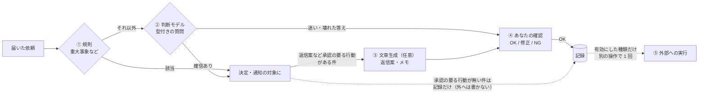

<h1 align="center">kimeru</h1>

<p align="center"><sub>kimeru（「決める」。リポジトリ名は pm-decision・<a href="docs/naming.md">名前について</a>） — approval-first decision drafts for PMs on Windows and Teams</sub></p>

<p align="center">
  <b>Teams・Azure DevOps・監視アラート・議事録で届いた依頼を 1 件ずつ読み、<br>
  「足りない情報・対応の進め方・返信案」をそろえて、PM の承認を待つツールです。</b><br>
  Windows と Teams で働く PM・開発リーダー向け。決めるのも、相手へ送るのもあなたです。<br>
  初期設定はキーワードによる簡易判定。合図は PC の通知で、スマホには通知されません。<br>
  承認した返信案は、あなたがコピーして相手に送ります（既定では kimeru は送りません）。
</p>

<p align="center">
  <a href="https://github.com/awano27/pm-decision/actions/workflows/ci.yml"></a>
  
  
  
  
</p>

<p align="center">
  <a href="#-実際の画面">実際の画面</a> ·
  <a href="#-まず動かす">まず動かす</a> ·
  <a href="#-使う前と後">使う前と後</a> ·
  <a href="#-しくみ">しくみ</a> ·
  <a href="#-検証の結果といまの制約">検証と制約</a> ·
  <a href="#-ドキュメント">ドキュメント</a>
</p>

---

| 届くもの（入力） | kimeru が用意するもの（出力） | あなたが決めること |
|---|---|---|
| 「リリース日を来週火曜にずらしてよいか判断お願いします。QA 環境が止まっていて…」（Teams の 1 対 1 チャット） | 判断の依頼と見分け、進め方の案（復旧見込みの確認 → 影響の確認 → 選択肢の比較 → 決定 → 通知）と返信案を用意する。返信は送らない（writer を設定すると、返信案はあなたの承認待ちになる） | 延期するか・範囲を絞るか、返信を送るか |
| 「checkout-api の 5xx が 23%」（監視アラート Sev1） | 重大事象の規則で、モデルに聞かずに障害対応の手順と通知の対象を記録 | 実際の連絡と障害対応 |
| 「ログ基盤を見直す」（議事録の 1 行。担当・期限なし） | 決定・タスク・リスクのどれか決めきれない行として、確認待ちにする | 担当と期限を決める |

この表の出力は、`try` と `demo`（簡易判定）で確かめたものです。足りない情報・選択肢・返信案の文面は、文章生成 AI（writer）を設定したときに相談の文面から書かれます。未設定なら、進め方の案と定型の返信文だけです。

---

## 🖼 実際の画面

`python -m kimeru try` を実行して作られたレポートです（架空の相談 1 件。画像は加工していません）。1 件の依頼について、**依頼 → 根拠 → 提案 → 人の確認 → 記録** を 1 画面で追えます。

<p align="center"></p>

- 記録の欄は、**判断（承認済みか）・作業（終わったか）・相手への送信（送ったか）** を別々に表示します。承認しても、送信や作業の完了にはなりません。
- 完成例の HTML: [docs/sample/try-report.html](docs/sample/try-report.html)（ダウンロードしてブラウザで開くと、インストール前に同じ画面を見られます）。スマホ幅の表示は [こちらの画像](assets/readme/try-report-mobile.png)。

自分とのチャットには、次の短い投稿として届きます（`try` の出力から抜粋）。

```text
[kimeru #1] 佐藤（QA）さん: リリース日を来週火曜にずらしてよいか判断お願いします。QA…
→ 佐藤さんに QA 環境の復旧見込みを聞く
案: 受領しました。QA 環境の復旧見込みを確認し、本日 15 時までに日程の判断をお返しします。
⚠ 元の材料に無い日付・数値あり（詳細 1）
OK 1 / NG 1 / 修正 1 <点> / 詳細 1
```

⚠ は、相談の文面に無い「15 時」を返信案が約束していることを示す印です（実際のチェックの結果）。体験では `修正 1 時刻は約束せず短く` と返して書き直させ、`OK 1` で承認します。

---

## 🚀 まず動かす

**必要なもの: Python 3.10 以上だけ。** 追加のパッケージ、アカウント、API キー、Teams、Azure DevOps は要りません（体験は Windows で確かめ、Linux は CI の試験で確かめています。macOS は未確認です）。

```powershell
git clone https://github.com/awano27/pm-decision.git kimeru
cd kimeru
python -m kimeru try
```

Git が無ければ [Code → Download ZIP](https://github.com/awano27/pm-decision) で取得して展開し、`README.md` と `kimeru` フォルダが並ぶ場所で `python -m kimeru try` を実行します。Windows では `try.cmd` をダブルクリックしても同じです（Python が無いときは入れ方を表示します）。

> **体験モードの約束**: この PC にある kimeru の設定ファイル・環境変数・API キーは読みません。AI モデル・外部 CLI・Teams・Azure DevOps には接続しません。Teams は模擬、判断は簡易判定、文面は台本に固定したうえで、処理中は Python からのプロセスの起動（`subprocess`・`os.system` など）とネットワーク接続（`socket`）を止めています。書き込むのは `out\try` だけで、終わると環境変数を元に戻します（[回帰テスト](tests/test_try.py)・[しくみ](docs/design.md#7-体験モードpython--m-kimeru-tryの隔離)）。

**目安の時間**: Python があれば 3 分以内です。作者の環境では clone が 2.2 秒、`try` が 1.0〜1.7 秒でした（回線と PC で変わります。[計測の記録](docs/try-verification.md)）。最後に `out\try\report.html` の場所が出るので、ブラウザで開きます。

**Python が無い場合**: Windows なら `winget install Python.Python.3.12`（または [python.org](https://www.python.org/downloads/) のインストーラーで「Add python.exe to PATH」に印）を実行し、PowerShell を開き直してから `python --version` で 3.10 以上と出ることを確かめます。会社の PC で入れられない場合は [管理された PC での導入](docs/managed-environments.md) を参照してください。

### 体験で起きること

`try` は「リリース延期の相談が届く → 不足情報を整理 → 対応案と返信案を確認 → 修正 → 承認 → 判断の記録を見る」を、1 件の架空の相談で順に表示します。

- **判断はキーワード一致の簡易ルールです。** 「判断お願いします」などの語で種類を決めているだけで、AI の推論ではありません。経路に出る 0.85・0.90 は固定値で、確率ではありません。
- **返信案・足りない情報・選択肢は台本の固定文です**（[examples/try_release_delay.json](examples/try_release_delay.json)）。⚠ の検査、承認待ちの扱い、修正・承認の記録は本物の処理です。
- **AI モデルを接続した場合**: 種類の判断は判断モデル（Kev または Jev）が型付きの質問に答えて行い、返信案と足りない情報は文章生成 AI（writer）が相談の文面から書きます。文面は今回と同じく承認を待ちます。
- 体験の承認は記録だけです。実際の送信や本番での承認にはなりません。

### もう少し見る: PM の 1 日（9 件）

Teams・アラート・ADO・議事録の 9 件を、規則と簡易判定で順に処理するデモです。

```powershell
python -m kimeru --backend stub --out out/demo demo --pace 0
```

`demo` の最後に、こう出ます。

```text
=== まとめ
    判断 9 件: 自動で決定 8 / 確信が低く安全側で決定 0 / 人の確認 1
    うち規則（安全網）で即決定 3 件、モデルの判断 17 回・合計 0.0 秒
    記録: out\demo\decisions.jsonl
    レポート: out\demo\report.html
```

結果は `out/demo/report.html` に出ます。件数は同梱の台本に対する結果で、業務での精度ではありません。`demo` は `try` と違い、この PC の設定（判断モデルや writer）を使います。設定がある PC では `try` を使ってください。

自分の Teams で 1 回動かすまでの順番は [最初の 30 分](docs/quickstart.md) に、毎日の使い方・承認の返信・止め方・困ったときは [使い方の詳細](docs/usage.md) にあります。

---

## 🔁 使う前と後

| | 使う前 | kimeru を使うと |
|---|---|---|
| 依頼を読む | Teams・ADO・アラート・議事録を、それぞれ開いて読む | 届いた順に読まれ、確認が要る件だけが自分とのチャットに短い投稿で届く |
| 何を聞くか考える | 原文から、足りない情報を自分で洗い出す | 足りない情報と選択肢が並んだ状態から始める（`詳細 N` で全文） |
| 返信を書く | 一から書く | 返信案を `OK N`・`修正 N <指示>`・`NG N` で返す |
| 決めたことを残す | メモや記憶に頼る | 判断の経路・修正・承認・作業の進捗が別々にファイルに残る |

**時間がどれだけ減るか、下書きがどれだけ使われるかは、まだ測っていません。** 測り方は [1 週間の試し方](docs/trial-week.md) にあります。

---

## 🧠 しくみ

**規則 → 判断モデル → 文章生成 → あなたの承認 → （有効にした種類だけ）実行**の順に、役割を分けています。判断ポイントと進め方の型（9 種類）は JSON で定義し、チーム向けに追加できます。



| 設計判断 | 理由 | 実装と試験 |
|---|---|---|
| 規則を判断モデルの前に置く | 障害のような見逃せない件を、モデルの答えに左右させない | [graph.py](kimeru/graph.py) の `severe_hit`・`guard_hit` / [test_severe_guards.py](tests/test_severe_guards.py) |
| 判断モデルは文章を書かず、型付きの答えだけ返す | 経路をしきい値で決め、迷ったら人へ回せる | [graph.py](kimeru/graph.py) の `route` / [test_kimeru.py](tests/test_kimeru.py) の `test_low_confidence_choice_goes_to_human` |
| 文章は writer が書き、承認まで外に出ない | 生成文の誤り・作り話を人が止められる | [cli.py](kimeru/cli.py) の `_draft` / [test_writer.py](tests/test_writer.py) |
| 承認と実行を分ける | OK は記録だけ。実行は種類ごとに設定し、別の操作で 1 回 | [execute.py](kimeru/execute.py) / [test_execute_safety.py](tests/test_execute_safety.py) |
| 結果不明の送信は自動で送り直さない | 二重送信より「本人が確認する」を選ぶ | [notify.py](kimeru/notify.py) の `_delivery_unknown` / [test_delivery_attempts.py](tests/test_delivery_attempts.py) |

詳しい説明・図・未実装の課題は [設計と安全のしくみ](docs/design.md) にあります。

**データの行き先（要点）**: 既定では判断はこの PC の中で行い、記録は `--out` のフォルダに残ります（判断の記録に残る元のメッセージは 120 文字まで。取り込んだ原本の全文は `daily` が 7 日で削除）。外部へ送るのは、Jev（TypeSafe のクラウド）を選んだとき、writer を設定したとき、Kev のリモート接続を明示許可したとき、スマホ通知（件数と番号だけ）を設定したときだけです。詳細は [使い方の詳細](docs/usage.md#-データの行き先) と [SECURITY.md](SECURITY.md)。

Kev をこの PC で動かす場合の準備は [Kev の持ち込み用フォルダ](docs/kev-bundle.md) にあります。開発 PC では `build-kev-bundle.cmd` で作れます（前提は git と uv。Kev のメモリは bf16 で約 10GB、fp32 で約 14GB）。

---

## 🔬 検証の結果といまの制約

**業務での有効性を検証している段階です。** 次の 4 つは別のものとして扱っています。

| 種類 | 結果 | 何を示し、何を示さないか |
|---|---|---|
| テスト | CI（Windows の Python 3.10〜3.12、Linux の 3.12）で全件合格が必須。体験モードの隔離・承認前に実行しないこと・入力中の指示・重大事象・情報不足・判断モデル停止の回帰テストを含む | コードが仕様どおりに動くこと。判断の正しさではない |
| 模擬データ（モデルなし） | ラベルどおりに答えたとき架空の 147 件がどの経路に進むかを `eval/golden.json` に固定し、変わると試験が落ちる | 規則とグラフの配線。モデルの精度ではない |
| 実モデル（Kev-4B）・架空データ | 開発用 99 件: 正しい 66・人へ 21・安全側 10・誤り 2・重大な取りこぼし 0。検証用 48 件: 36・9・0・3・0（CPU fp32、2026-10-13） | 作者が作った架空のイベントでの結果。**検証用 48 件も質問文の選定とガードの設計に使ったため、開発に使っていないデータでの評価はまだありません**（[評価資料](docs/evaluation.md#評価データの来歴)） |
| 実業務 | まだありません | 判断精度・時間短縮・下書き採用率・承認までの時間は未測定 |

判断の速さは、作者の PC の CPU（fp32）で 1 件平均 10.7 秒・最大 39 秒でした。判断モデルの確信度は、人へ回すかを決めるしきい値に使う値で、正解の確率ではありません。

| 状態 | 内容 |
|---|---|
| ✅ **実装済み** | 4 種類の入力の判断 / 手順・返信案 / 承認・修正・保留 / 作業進捗 / 要件ドラフト / HTML レポート。モデルなしの体験とデモで流れを試せる |
| 🔬 **利用環境での確認が必要** | Teams の取り込みと自分とのチャットへの投稿 / Kev・Jev 接続 / writer / PC・スマホ通知 / ADO コメントの実行 / 全文読み取り / 定期実行。監視アラートの取り込みと Claude・Grok の下書きは実機の確認が必要。相手への返信の送信（`送る N`）/ `停止`・`再開`・`休み` / 約束・返事待ち・前例・差分の朝まとめなどの opt-in 機能（どれも既定では無効） |
| 🧪 **実験的** | `m365-auto`（Teams 内の Microsoft 365 Copilot の画面操作。画面の作りに依存し、失敗すると 30 分休んで手動の依頼文に切り替わる） |
| ⛔ **現在は使えない** | Codex による AI 下書き。選んでも定型文にフォールバックする |
| ⏳ **これから** | 開発に使っていないデータでの評価 / 実データでの評価 / スマホへの通知の実機確認 / `m365-auto` を複数環境で確認して実験的から外す |

**向かない使い方**: Mac・Linux での Teams 連携（Teams の読み取りは Windows の画面操作）、Slack や Google Chat が中心の職場、返信や起票まで全自動にしたい場合（kimeru は承認制で、既定では記録だけ）。Teams の画面を自動操作するので、組織で認められているかを先に確かめてください。

---

## 📚 ドキュメント

| 知りたいこと | ドキュメント |
|---|---|
| デモから自分の Teams で 1 回動かすまで | [最初の 30 分](docs/quickstart.md) |
| 毎日の使い方・承認の返信・止め方・困ったとき・writer・データの行き先 | [使い方の詳細](docs/usage.md) |
| 設計の理由・安全のしくみ・未実装の課題 | [設計と安全のしくみ](docs/design.md) |
| 体験の手順を新しい環境で確かめた記録 | [体験の検証記録](docs/try-verification.md) |
| 管理された PC へ持ち込む・実機で確認する | [導入](docs/managed-environments.md) / [実機確認](docs/managed-pc-check.md) |
| コマンド・設定・入力形式・グラフを書く | [リファレンス](docs/reference.md) |
| 判断モデルを持ち込む | [Kev の持ち込み用フォルダ](docs/kev-bundle.md) |
| 下書き用の LLM を選ぶ | [writer](docs/writers.md) |
| スマホ通知・ADO コメントを有効にする | [push 通知](docs/push-notification.md) / [ADO コメント](docs/execute-ado-comment.md) |
| 承認した返信を相手に送る（`送る N`）を有効にする | [相手への返信の送信](docs/execute-teams-reply.md) |
| 要件ドラフトを作る・議事録を取り込む | [要件ドラフト](docs/requirements.md) / [議事録の形式](docs/minutes-format.md) |
| 精度・評価データの来歴・動作確認 | [評価と既知の課題](docs/evaluation.md) / [eval/README.md](eval/README.md) |
| 効果を測る | [初回の観察](docs/first-run-observation.md) / [1 週間の試行](docs/trial-week.md) |
| 安全・開発・変更点 | [セキュリティ](SECURITY.md) / [貢献](CONTRIBUTING.md) / [変更履歴](CHANGELOG.md) |

Issue と PR を歓迎します。「利用結果の報告」「動作環境の報告」「不具合」の Issue 様式があります。テストの回し方は [CONTRIBUTING.md](CONTRIBUTING.md)。

## 📄 ライセンス

MIT（[LICENSE](LICENSE)）。Kev と Qwen3.5 のモデルはそれぞれ Apache-2.0。
