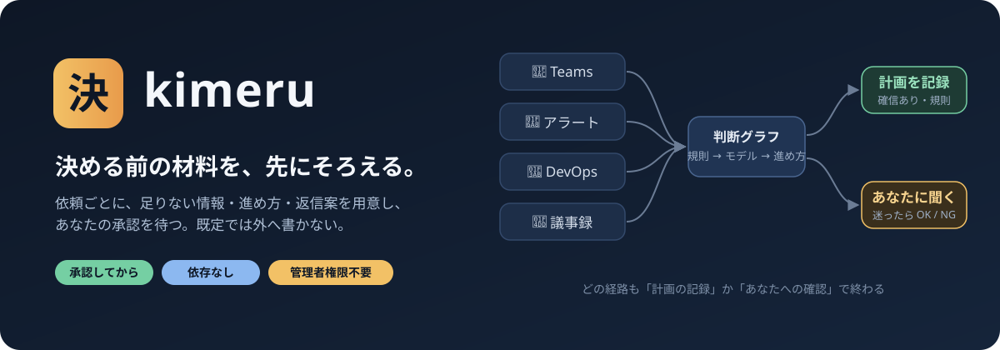
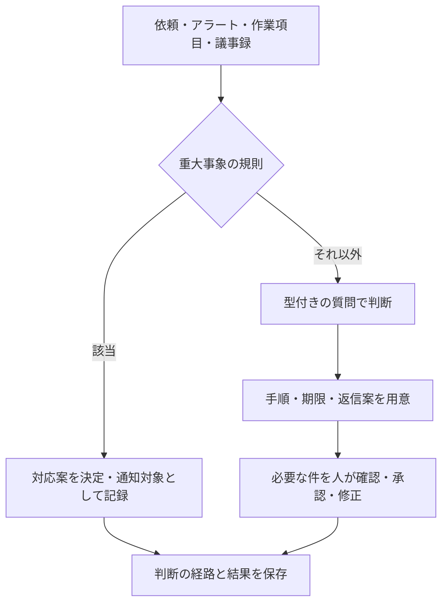
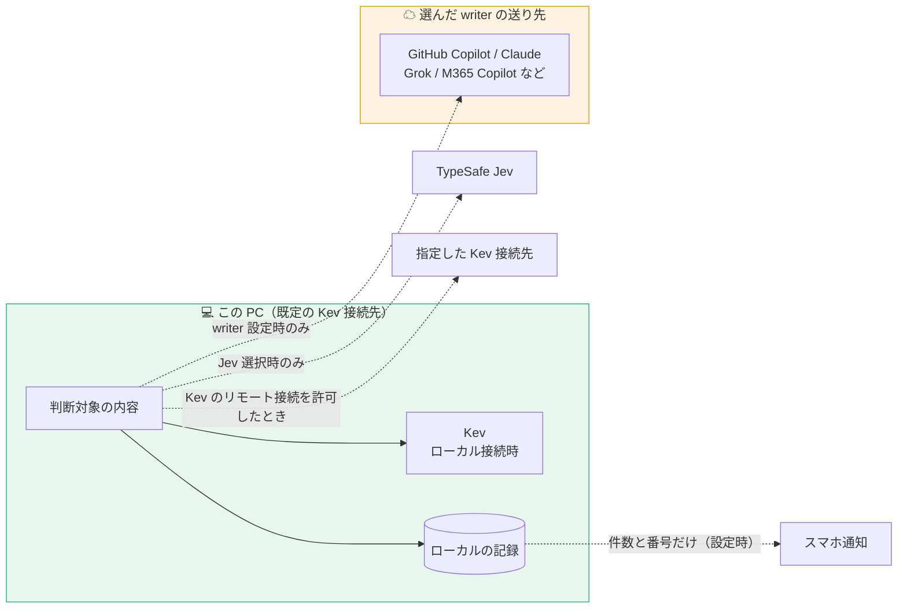

<p align="center">
  
</p>

<h1 align="center">kimeru</h1>

<p align="center"><sub>kimeru（「決める」。リポジトリ名は pm-decision・<a href="docs/naming.md">名前について</a>） — approval-first decision drafts for PMs on Windows and Teams</sub></p>

<p align="center">
  <b>届いた依頼から、次にやることと返信案を用意する。</b><br>
  Windows と Teams で働く PM・リーダー向けの業務整理ツール。<br>
  チャット・アラート・チケット・議事録を見て、対応手順と確認すべき点をまとめ、未完了の作業を追えます。<br>
  初期設定はキーワードによる簡易判定。合図は PC の通知で、スマホには通知されません。<br>
  承認した返信案は、あなたがコピーして相手に送ります。
</p>

<p align="center">
  <a href="https://github.com/awano27/pm-decision/actions/workflows/ci.yml"></a>
  
  
  
  
  
  
  
</p>

<p align="center">
  <a href="#-30-秒でわかる-kimeru">30 秒でわかる</a> ·
  <a href="#-ダウンロードだけで動きますか">動かすために必要なもの</a> ·
  <a href="#-まず動かす">まず動かす</a> ·
  <a href="#-毎日の使い方">毎日の使い方</a> ·
  <a href="#-データの行き先">データの行き先</a> ·
  <a href="#-いまの状態">いまの状態</a> ·
  <a href="#-ドキュメント">ドキュメント</a>
</p>

---

## ⏱ 30 秒でわかる kimeru

**依頼を読んで、対応手順・返信案・確認待ちの一覧を作ります。** 判断が難しい件は Teams の自分とのチャットであなたに確認します。たとえば、次のような場面で使えます。

| 困っていること・入力例 | kimeru が用意するもの | あなたがすること |
|---|---|---|
| **リリース延期の相談** — 「QA 環境が止まった。日程を変えてよい？」 | 復旧見込みの確認 → 影響するチームの確認 → 選択肢の比較、という手順と返信案 | 必要な情報を集め、案を確認・修正して相手へ送る |
| **障害の通知** — 「決済 API のエラーが増え、顧客が支払えない」 | 重大事象を規則でチェックし、障害対応の手順と通知対象を記録 | 通知を見て、実際の連絡・障害対応を行う |
| **情報不足のチケット** — 「CSV 出力を追加したいが、受け入れ条件は未定」 | 足りない情報の確認案。登録された案件とあなたの回答から、ローカルの要件案も作成できる | 必須・任意・対象外・受け入れ条件を回答し、内容を確認する |
| **会議後の宿題** — 「ログ基盤を見直す。担当・期限は未定」 | 議事録を決定・タスク・リスクに分け、担当・期限の確認案を用意 | 議事録を指定形式で保存し、担当や期限を決める |

連携や判断モデルを準備した後の利用例です。実際の入力に対する判断精度は、あなたの業務で確認してください。

### ほかにできること

- **朝のまとめを見る** — 確認待ちと、承認済みの未完了作業を分けて、今日の優先事項をまとめる。
- **要件案をファイルに残す** — 確認待ちとして登録された案件と、あなたが入力した回答を Markdown / JSON に保存する。未回答の項目は不明として残る。
- **承認後の進捗を追う** — 作業中・完了・停止中を手動で記録する。承認しただけで完了にはしない。
- **判断を見返す** — HTML レポートで判断の経路と結果を見る。週次集計や、導入前後の確認時間の記録もできる。

**既定では、相手への返信・起票・当番呼び出しを実行せず、計画として記録します。** 自分とのチャットへの投稿は `--send`、ADO コメントの実行は別の設定と文面の承認が必要です。

---

## 📦 ダウンロードだけで動きますか

**PC に Python 3.10 以上があれば、ソース ZIP だけでデモ・サンプルの判断・HTML レポートを動かせます。Python がない PC では、ZIP を展開するだけでは動きません。**

[Code → Download ZIP](https://github.com/awano27/pm-decision) と [Releases の Source code](https://github.com/awano27/pm-decision/releases) には、kimeru 本体・判断の規則・対応手順・サンプル・起動補助スクリプトが入っています。**Python 本体、Kev のモデル、Azure CLI、文章生成用の CLI は同梱されていません。**

| 使いたい機能 | ソース ZIP に加えて必要なもの |
|---|---|
| **まず体験する** — 同梱デモ、JSON サンプルの処理、HTML レポート | Python 3.10 以上。追加の Python パッケージや API キーは不要 |
| **記録をローカルで扱う** — 登録済み案件の作業一覧、要件案の保存 | Python 3.10 以上と既存案件の記録。要件の未回答項目は不明として保存する |
| **モデルで判断する** | Kev の実行環境とモデル、または Jev の API キーと接続環境。ZIP の初期設定はキーワードによる簡易判定 |
| **Teams の依頼を読む・承認する** | Windows のデスクトップ版 Teams、サインイン済みのアカウント、自分とのチャットの動作確認 |
| **ADO・監視アラートを取り込む** | Azure CLI、本人のサインイン、対象プロジェクト・サブスクリプションへの権限 |
| **LLM で返信案やメモを書く** | 選んだ writer の CLI・モデル・利用可能なアカウント、または Microsoft 365 Copilot の環境。未設定なら定型文 |
| **スマホに通知する** | 通知経路の設定と、実際の端末での受領確認。自分との Teams チャットへの投稿だけでは通知されない |

2026-10-15 に公開 main と v1.1.0 のソース ZIP を取得し、Python 3.11・追加パッケージなし・通信を禁止した環境で、9 件のデモ、1 件のサンプル、HTML 生成、作業一覧、要件案の Markdown / JSON 保存を確認しました。Teams・ADO・実モデルとの連携や、すべての Windows PC での動作を確認した結果ではありません。

<details>
<summary><b>インストールできない管理された PC に持ち込む場合</b></summary>

Python・Kev・Azure CLI をまとめた持ち込み用パッケージは、別途準備した環境から `tools/make-bundle.ps1` で作れます。通常のソース ZIP にこれらが含まれているわけではありません。2026-10-15 時点の公開リリースには Source code の ZIP / tar.gz があり、これらを同梱した実行用パッケージは公開されていません。

`START.cmd` は、Python・Kev・Azure CLI などの配置を確かめ、準備と対話式チェックを進める入口です。ソース ZIP だけで全機能を起動するボタンではありません。パッケージの作成はコミット済みファイルを使うため、手元の未コミット修正は含まれません。詳細は [管理された PC での導入](docs/managed-environments.md) を参照してください。

</details>

---

## 🚀 まず動かす

**最初は、実際の Teams や ADO に接続せず、架空の PM の 1 日を試します。**

1. [Code → Download ZIP](https://github.com/awano27/pm-decision) から取得して展開する。
2. 展開先の `README.md` と `kimeru` フォルダが並んでいる場所で PowerShell を開く。
3. `python --version` で 3.10 以上が表示されることを確認し、次を実行する。

```powershell
python -m kimeru --backend stub --out out/demo demo --pace 0
```

Git を使う場合は、次の手順でも同じデモを試せます。

```powershell
git clone https://github.com/awano27/pm-decision.git kimeru
cd kimeru
python -m kimeru --backend stub --out out/demo demo --pace 0
```

9 件のイベントを処理し、**`out/demo/report.html`** に判断の経路・対応案・確認待ちをまとめます。ブラウザで開いて結果を確認してください。

`demo` の最後に、こう出ます。

```text
=== まとめ
    判断 9 件: 自動で決定 8 / 確信が低く安全側で決定 0 / 人の確認 1
    うち規則（安全網）で即決定 3 件、モデルの判断 17 回・合計 0.0 秒
    記録: out\demo\decisions.jsonl
    レポート: out\demo\report.html
```

> `stub` はキーワードによる簡易判定です。デモ内の Teams は模擬で、実際の Teams や ADO には書き込みません。件数は同梱シナリオの結果で、実際の業務精度を示すものではありません。writer を設定している場合は、その送り先にも注意してください（[データの行き先](#-データの行き先)）。

1 件だけ試すなら、デモとは別の出力先に保存できます。

```powershell
python -m kimeru --backend stub --out out/example run examples/teams_chat.json
```

### Teams では、こう使う

Teams の連携と writer を設定すると、確認待ちの件に元の依頼・判断メモ・返信案を添えて、自分とのチャットへ投稿します。下は架空の依頼を使った説明例です。writer が未設定なら、返信案は定型文になります。

迷った件は、自分とのチャットに **1 通の短い投稿**（5 行ほど）として届きます。

```text
[kimeru #1] 佐藤（QA）さん: リリース日を来週火曜にずらしてよいか判断お願いします。QA…
→ QA 環境の障害の詳細と復旧見込みを佐藤さんに確認する
案: 受領しました。まず遅延原因の復旧見込みを確認させていただきます。
OK 1 / NG 1 / 修正 1 <点> / 聞き返し 1 / 詳細 1
```

確認待ちは短い投稿で届き、`詳細 1` で元の文面・判断メモ・下書きの全文を確認できます。スマホから `修正 1 もっと短く` と返すと、同じ番号で改訂して確認を求めます。`OK 1` で承認した文面はコピーして相手に送れます。**承認したことと、送信・作業が完了したことは別に記録します。**

実際の Teams で試す準備は [管理された PC での導入](docs/managed-environments.md) と [実機確認の手順](docs/managed-pc-check.md) を参照してください。デモから自分の Teams で 1 回動かすまでの順番は [最初の 30 分](docs/quickstart.md) にまとめています。

---

## 🧠 しくみ

**規則 → 判断モデル → あなたの確認**の順に処理します。判断ポイントと進め方の型（9 種類）は JSON で定義し、自分のチーム向けに追加できます。



**判断モデルは文章を書きません。** 「これは判断依頼か」「今すぐ人を呼ぶか」といった質問に、型付きの答えと確率を返します。文章を書く LLM（writer）は任意で、生成した文面は人の確認を待ちます。

| 段 | 何をするか | 結果 |
|---|---|---|
| ① 規則 | 障害・全ユーザー影響などを、モデルに聞く前に拾う | 対応案を決定し、通知対象にする |
| ② 判断モデル | 確率とグラフの条件に沿って、決定するか確認を求めるかを選ぶ | 判断の経路と確信度を記録 |
| ③ あなた | 迷った件、重大度とモデルの評価が食い違った件を確認する | 承認・却下・保留・修正を記録 |

既定はデモ用の `stub` です。業務で使う判断モデルは、設定・起動して選びます。

| 判断モデル | 内容の送り先 | 準備 |
|---|---|---|
| **Kev** | 既定はこの PC の `http://127.0.0.1:8009/v1` | Kev を起動し、`--backend kev` を指定 |
| **Jev**（TypeSafe） | TypeSafe のクラウド API | `TYPESAFE_API_KEY` を環境変数で設定し、`--backend jev` を指定 |

Kev のリモート接続は、`kev_url_remote_ok=1` で明示許可した場合だけ利用できます。セットアップは [導入手順](docs/managed-environments.md)、グラフ・設定・環境変数は [リファレンス](docs/reference.md) を参照してください。

Kev のモデルを持ち込む方法は [Kev の持ち込み用フォルダ](docs/kev-bundle.md) にあります。開発 PC では `build-kev-bundle.cmd` をダブルクリックすると、その手順を 1 回で実行します（前提は git と uv。Kev のメモリは bf16 で約 10GB、fp32 で約 14GB、ディスクは約 11GB。約 10GB の取得の前に `[y/N]` で尋ねます）。管理された PC の PowerShell が ConstrainedLanguage の場合、Teams の画面読み取りは動きません。利用前に [実機確認](docs/managed-pc-check.md) で確かめてください。

設定 `learn=1` のときは、種類が決まらない議事録の行に限り、「不要」のフィードバックから作った規則を本人が承認すると、その言い回しを確認待ちにせず記録だけにすることがあります。取り消しは `python -m kimeru learn revert A<番号>` です。

---

## 🙋 向いている人と向かない人

| 向いている | 向かない |
|---|---|
| Windows の PC と Teams で働く PM・リーダー | Mac / Linux（Teams の読み取りが Windows の画面操作のため） |
| 管理者権限なしの管理された PC で、持ち込み用フォルダから試したい | Slack や Google Chat が中心 |
| 判断をローカル接続で行いたい（Kev の接続先をこの PC にする） | 返信や起票まで全自動でやってほしい（kimeru は承認制で、既定では記録だけ） |
| 「決める前に、材料と選択肢を並べてほしい」 | 判断そのものを LLM に任せたい |

---

## 📅 毎日の使い方

**朝にまとめを見る → 日中に必要な件を確認する → 終わった作業を記録する。** Teams 連携と判断モデルを準備した後の流れです。

| いつ | kimeru がすること | あなたがすること |
| --- | --- | --- |
| 朝 8 時 | 今日の要点と、やることの上位 3 件を自分とのチャットへ | 読む |
| チャットが来たとき | 判断依頼か・急ぎかを判断し、進め方・返信案・判断メモを用意 | `OK N` / `NG N` / `修正 N …` / `聞き返し N` で確認待ちに返す |
| アラートが鳴ったとき | 重大なら対応案を記録して通知対象にする。将来のリスクなら予防タスク案 | 通知と対応案を確認する |
| チケットが起票されたとき | 重大バグの優先度や、情報不足の確認コメント案を用意 | 確認待ちの文面や対応案を確認する |
| 会議の後 | 議事録の 1 行ずつを決定・タスク・リスクに仕分け | Copilot の要約を `.txt` で置く（[形式](docs/minutes-format.md)） |

```powershell
python -m kimeru --backend kev daily --once --send   # 1 サイクルを実行し、自分とのチャットへ投稿
```

`--send` は実際に投稿します。接続先・自分とのチャット・利用する writer を [実機確認の手順](docs/managed-pc-check.md) で確かめてから実行してください。管理された PC の手順書には、Teams が定期的に切り替わる問題が解決するまで自動運転を使わない旨の注意があります。まずは `--once` で 1 サイクルずつ確認してください。

取り込みと通知の条件:

- **Teams は、画面のチャット一覧から読みます**（UI Automation。画面に表示されている範囲だけを読みます。組織で使う前に、画面の自動操作が認められているかを確認してください）。ほかのチャットを開いて全文を読むのは、設定 `read_full=1` にしたときだけです（開いたチャットは既読になります）
- ADO とアラートは、本人の `az login` で取得します
- 判断モデルが止まっている間のイベントは受信箱に残り、復帰後に判断されます（同じイベントを二重に判断しません）
- 自分とのチャットへの投稿は、あなたのスマホや PC には通知されません。そこで kimeru は **PC に Windows の通知** を出します（クリックで自分とのチャットが開く。`KIMERU_TOAST=0` で止める）。iPhone には、**件数と番号だけ** を届ける経路を選べます（[docs/push-notification.md](docs/push-notification.md)）

### 承認の返信

| 返信 | 動き |
|---|---|
| `OK N` | 下書きのまま承認し、行動を **記録**（相手への送信・起票はしません）。ADO へのコメントを有効にしているときは、`--send` を付けない実行の OK は記録だけで、ADO へは次の `--send` の実行で 1 回書きます |
| `送る N` | 既定では何もしません。`execute teams.reply` を設定しているときだけ、承認した返信の文面を、相手の 1 対 1 のチャットへ PC の Teams から **1 回** 送ります（`OK` だけでは送らない。送れたかは `[kimeru 実行 #N k]` で返す）。[手順](docs/execute-teams-reply.md) |
| `詳細 N` | 全文（元のメッセージ・判断メモ・すべての下書き・足りない情報）を `[kimeru 詳細 #N]` として返します。承認ではなく、何も記録しません。返信 1 通につき 1 回答えます |
| `NG N` | 却下として記録。提案した行動は実行しません |
| `保留 N` | 後で決める。次のまとめにも残ります |
| `修正 N <指示>` | 指示に沿って書き直し、同じ #N で出し直します |
| `聞き返し N` | 「聞き返しの返信」を返信の下書きにして、同じ #N で出し直します。`OK N` で記録 |

承認した返信の文面は、送る文面だけを `[kimeru 送信用 #N]` として自分とのチャットへ返します（既定では相手へは送りません。`execute teams.reply` を設定し、`送る N` と返したときだけ 1 回送ります）。`KIMERU_SEND_READY_SPLIT=1`（既定 0）にすると、見出し（相手の名前と案内）と本文を 2 通に分けて返すので、本文は 1 行目の `[kimeru 本文 #N]` だけを消してコピーできます。

<details>
<summary>期限を付けた保留・学習・作業完了・送信済みの返信</summary>

| 返信 | 動き |
|---|---|
| `保留 N <いつ>`（例: `保留 3 明日`、`保留 3 金`、`保留 3 来週`、`保留 3 15時`、`保留 3 3日後`、`保留 3 10/20`） | その日の朝（設定 `brief_hour`、既定 8 時）まで保留し、その日に同じ #N で出し直します（1 行目に `（保留から・2 日目）`）。出し直しは 1 回の返信につき 1 回で、承認・却下・実行はしません。読めない語（`保留 3 来月`）や 8 日以上先は日付なしの保留になり、次の投稿の 1 行目に `保留（日付なし）` と一度出します |
| `違う N` | （設定 `KIMERU_LEARN=1` のとき）#N の最終結果が違ったと、正誤として記録します。件の状態・投稿・承認・実行は変わりません |
| `違う N k` | （`KIMERU_LEARN=1` のとき）直前の `詳細 N` に出した「迷った質問」の k 番が正しい答えだったと、正誤として記録します（記録だけ） |
| `不要 N` | （`KIMERU_LEARN=1` のとき）#N は見る必要がなかったと、NG と同じく却下します。同じ言い回しの「不要」が 2 日にわたり 3 回・OK 0 のとき、その言い回しを記録だけにする規則の札を出します（議事録の行で、種類が決まらないものに限る）。OK で規則になります |
| `着手 N` | （`KIMERU_PROMISES=1` のとき）承認した件の作業を「着手」と記録します（`kimeru work set N in_progress` と同じ記録）。件の状態・投稿・承認・実行は変わりません |
| `完了 N` | （`KIMERU_PROMISES=1` のとき）承認した件の作業を「完了」と記録します（`work set N done` と同じ記録）。**ADO の結果は閉じません**。ADO の結果を閉じるのは `済 N` だけです |
| `完了 N k` | （`KIMERU_PROMISES=1` のとき）期限の投稿に出した手順 k（件の中の番号）を完了と記録します。件の状態は変わりません。その手順は翌朝の期限の投稿・朝のまとめ・約束の節から外れます |
| `延期 N <いつ>`（例: `延期 3 金`） | （`KIMERU_PROMISES=1` のとき）承認した件の期限を、その日に決めます（読む語は `保留 N <いつ>` と同じ）。決めた日は絶対日付で記録し、次の周期でずれません。承認・実行は変わりません |
| `送った N` | （`KIMERU_SENT_WATCH=1` のとき）承認した返信を相手に送ったと記録し、その件の「未送信」の催促を止めます。承認の投稿か、その件の催促（`[kimeru 未送信 #N]`）の下に書いたものだけ数えます（承認の投稿が画面の外へ流れていても、催促の下なら数えます）。件の状態・投稿・承認・実行は変わりません |

（`KIMERU_PROMISES=1` のとき）期限の投稿: 今日が期限の作業（承認した件の手順のうち、今日・今週までの期限が今日以前のもの。7 日まで）があると、設定 `nudge_hour`（既定 8 時）から 1 日 1 通、`[kimeru 期限 #3 #5]` を自分とのチャットに出します。終わったら、その投稿の下に `完了 3 2` のように返信します。手順の番号は、投稿に書いてある番号です。`完了 3 2` で完了と記録した手順は、翌朝の期限の投稿・朝のまとめの手順の行・約束の節から外れます（件は開いたままで、件の残りの手順は残ります）。

朝のまとめの「状況の確認（返信は送っていません）」は、kimeru が Teams の相手へ返信しなかった件で、返信は PM が自分で送ります。

確認待ちの件に、同じ人からのお礼・了解だけのメッセージが続いたときは、件の続きの 1 行に足すだけで、投稿し直しません（何も返信せず、保留や承認の状態も変えません）。件の続きで出し直すときは、1 行目に最初の依頼を残し、続きは `続き「…」` の 1 行で示します（保留だった件は `（前回 保留）` と付き、OK か NG で消えます）。

</details>

ADO コメントを実際に書く場合は、`execute ado.comment` の設定と文面の承認が必要です。実行結果の確認や `再実行 N-k`・`済 N` の使い方は [ADO コメントの実行](docs/execute-ado-comment.md) にまとめています。

### 承認した後の作業と、届いたか分からない通知

朝のまとめは、確認待ちと承認済みの未完了作業を分けて表示します。承認だけで作業が完了したことにはしません。手動の進捗は次のように記録できます。

```powershell
python -m kimeru --out <出力先> work list
python -m kimeru --out <出力先> work set 1 in_progress
python -m kimeru --out <出力先> work set 1 done
```

`done` は実際の作業が終わってから付けるローカルの進捗です。ADO の状態は変更しません。送信の結果が分からない場合は自動再送を保留し、本人が確認してから解除します。操作は [進捗と配信の確認](docs/reference.md#手動の進捗と曖昧な配信の確認) を参照してください。

同梱の判断グラフと進め方の型の一覧は [docs/reference.md](docs/reference.md#入力形式) に、会話で新機能の要件を検討する例は [シナリオ](docs/scenarios/requirements-review.md) にあります。既存 case からローカル要件ファイルを作る操作は [要件ドラフト](docs/requirements.md) を参照してください。

<details>
<summary>定期実行の登録（実機確認後。実際に投稿する設定）</summary>

管理された PC では、先に手順書の自動運転の注意を確認してください。登録したタスクは常に送信を有効にして動きます。短時間の試行や停止方法は [実機確認の手順](docs/managed-pc-check.md) を参照してください。

```powershell
python -m kimeru schedule install                    # タスクスケジューラに登録して自動運転（管理者権限不要。登録されるのは daily --once --send で、自分とのチャットへ実際に投稿する）
```

</details>

### 止める・消す

- **スマホから止める**: 自分とのチャットに、行全体で `停止` とだけ打つと、`daily` は取り込み・判断・投稿・通知・push・承認の実行を止めます（期限の掃除は続けます）。`再開` と打つと戻り、停止中に打った OK は再開後に効きます。**停止中は、重大な知らせ（Sev0/1）も届きません。** 止める語を使わないときは `python -m kimeru config set control_words 0`（既定は `1`）。
- **時刻まで静かにする**: 自分とのチャットに `休み 15時`（または `休み 明日`）と打つと、その時刻まで緊急でない件の PC の通知と push を出しません。取り込み・判断・投稿は続き、重大な件（Sev0/1 など）はすぐ届きます。時刻が来ると、止めていた件を 1 回にまとめて知らせます。`python -m kimeru config set quiet_words 1` で使えます（既定は `0`。`control_words=1` が要ります）。`停止` は休みより強く、`再開` では休みは終わりません。

```powershell
python -m kimeru schedule remove        # 自動運転のタスクを消す（残るものを表示します）
python -m kimeru config unset backend   # install のときに保存した判断モデルの既定を戻す（ado_org・ado_project も同じ）
```

- 記録の場所: `--out` で指定したフォルダです。この README のデモは `out\demo\`、1 件のサンプルは `out\example\` に保存します。取り込んだ原本は inbox の `done/` に全文で残り、`daily` が既定 7 日で消します。`setup-managed` で入れた場合の出力先は `%LOCALAPPDATA%\kimeru` です。保存先を確かめ、不要になった記録を削除してください
- `out\run-daily.vbs`（自動運転の起動用）は `schedule remove` のあとも残ります。手で消せます
- 状態フォルダ（既定 `%LOCALAPPDATA%\kimeru`。`config.json`・`self-name.txt`・`reviews.jsonl`・`fixtures_user.jsonl` など）は `schedule remove` では消えません。消すときはフォルダごと削除します
- `setup-managed` で入れた場合は `.\setup-managed.cmd remove`（[手順](docs/managed-pc-check.md)）

### 困ったとき

| 表示・症状 | すること |
|---|---|
| 「判断モデルに接続できません」 | Kev を起動する（[しくみ](#-しくみ)）か、`--backend stub` で試す |
| 「TYPESAFE_API_KEY is not set」 | Jev の鍵を取得して設定する（[しくみ](#-しくみ)）。鍵が無ければ `--backend stub` か `kev` |
| 「判断グラフ／進め方の型のフォルダが見つかりません」 | clone したフォルダで `python -m kimeru` を実行する（pip での導入は未対応） |
| 「デモ以外の記録があります…消さずに止めました」 | デモは別の `--out` で動かす（既定は `out\demo`）。その記録を移してよければ `--fresh` |
| 取り込みに失敗した件（`inbox\done\*.error`） | 原因を直してから `python -m kimeru retry` |
| 自分とのチャットへ投稿できたか分からない件 | `run-fix-deliveries.cmd` をダブルクリック（質問しない。自分とのチャットを 1 回読み、届いていた件は確認済みに、見当たらない件は次のサイクルで送り直し、24 時間より古い件は送り直さず閉じる。結果は件数と番号だけで `kimeru-fix-deliveries-result.txt` に出る）。1 件ずつ見るなら `python -m kimeru delivery list`、確かめてから `delivery retry` か `delivery confirm` |
| 投稿が「配信結果不明」になる・すべて PM へ回る理由を調べたい | `run-diagnose.cmd` をダブルクリック（質問しない・何も送らない。結果は数と節点の名前だけで、`kimeru-diagnose-result.txt` とクリップボード、Google ドライブの `kimeru-release` へ） |
| 発表の場で判断モデルが使えない | 前日に `demo --record <ファイル>` で記録しておき、当日は `demo --replay <ファイル>` |
| Teams のチャット一覧が 0 件と読まれる | Teams の左側の「チャット」タブを開き、一覧が見えている状態にしてから実行する |
| 「Teams のウィンドウが表示されていません（起動はしています）」／「Teams が起動していません」と出る | 前者は Teams が動いていて、ウィンドウが隠れている（トレイ常駐）。Teams のウィンドウを開き、チャット一覧を表示してから実行する。後者は Teams を起動する。kimeru は Teams を自動では起動・表示しません |
| 毎日 `--once` を手で動かさず、時間を限って自動運転を試したい | `.\setup-managed.cmd trial`（既定 8 時間で自動的に止まり、結果ファイル `kimeru-autorun-result.txt` ができる。途中で止めるのは `.\setup-managed.cmd remove`。[手順](docs/managed-pc-check.md#毎日動く状態にする確認が-ok-だったら)） |
| 管理された PC で動くか確かめたい | `run-auto-check.cmd` をダブルクリック（何も送らない・質問しない。結果は OK/NG と件数だけ）。送信を伴う確認は `run-check.cmd`（[手順](docs/managed-pc-check.md)） |

### 最初の試行: 1 つの ADO プロジェクトで情報不足を確認

最初は対象の ADO プロジェクトを 1 つに絞り、情報が足りない作業項目の確認を記録します。`requirements build` は、case の記録と明示した回答からローカルの要件案を作り、`requirements approve` はその Markdown と JSON の現在内容をローカルで承認します。この操作は ADO や Teams の承認・状態を変更しません。手順は [要件ドラフト](docs/requirements.md) と [試行の測り方](docs/trial-week.md) にあります。

試行では、導入前後に同じ種類の確認にかかった分数、下書きをそのまま使ったか・直して使ったか・使わなかったか、本人が通知を受け取ったか、作業を手動で完了したかを記録します。ほかのシナリオは任意の追加検証です。業務上の時間短縮や判断精度はまだ測定していません。

### 待ち時間と下書き利用の計測

<details>
<summary>集計の意味・共有する方法・不明として扱う条件</summary>

`out/decisions.jsonl` に判断・writer の処理秒数、下書き準備時刻、計測用の世代と出所を残し、`out/report.html` で承認記録・明示した試行記録と照合します。本文を含む通常の HTML はローカル確認用です。共有する場合は `python -m kimeru trial report --share` を使います。週の数字は `kimeru digest --week` で見られ、到着から判断・承認までの中央値は実測の件数と不明の件数つきで出ます。設定 `weekly_report=1` のときは、月曜の朝のまとめの末尾にも同じ 6 行が入ります。

| 指標 | 測るもの / 未測定のもの |
|---|---|
| 手動の確認時間 | 人が材料・下書きを読んで修正し、行動を選んだ実作業の分数を `trial record` に明示します。放置・中断の待ち時間やモデル処理時間を混ぜません。before/after は記述的な比較で、因果的な時間短縮の証明ではありません。 |
| 判断・writer の処理時間 | 既存の処理秒数です。イベントの到着から意思決定までの時間ではありません。 |
| 下書き採用率 | 利用可能な下書きがある case のうち、明示記録した最新の利用状況から `(unchanged + edited) / (unchanged + edited + unused)` を数えます。未回答の件数と観測率も表示し、`OK` や配信だけでは採用とみなしません。 |
| 投稿待ち / 観測した承認待ち | 下書き準備から自分とのチャットの本文を読み戻して確認するまでと、その確認から `OK` をアプリが受け付けるまでを分けます。後者には返信ポーリング・保留が含まれ、本人が返信した瞬間やスマホの反応時間ではありません。 |
| イベント到着から承認まで | PC がイベントを見た時刻から決めた到着から承認（読み戻しで確認した件だけ）までです。Teams は、前回見た時刻と今回見た時刻の 15 分以内の窓にチャットの時刻ラベル（HH:MM）が入るときだけそのラベルを到着とし、それ以外は観測の時刻を使い、窓の幅を残します（`arrival_source`: `label` / `observed`）。ADO は作成時刻、アラートは発生時刻です。初回・一覧が空だった直後・窓が 15 分を超えた件は **Unknown** のままで、推定しません。送信者が送った時刻ではありません。古い記録・不正・未来・逆転・世代不一致の時刻も推定しません。 |

修正・貼り付け・聞き返し・追加情報で提案が変わった場合は、計測だけの世代を更新します。承認番号や承認・再実行の条件は変えません。古い記録、曖昧な配信、時刻不足・不正・逆転は `Unknown` と件数で示します。後から本人が配信を確認した時刻は元の投稿時刻には置き換えません。**実業務での下書き採用率・承認待ち短縮・時間削減効果は、まだ測定していません。**

新しい隔離フォルダで `python -m kimeru --backend stub --out <デモ専用出力先> demo --pace 0` を実行すると、待ちの演出を省いたオフライン demo と HTML を作れます。ユーザー設定を読むため、既存設定がある環境では `KIMERU_STATE_DIR` も空の試験専用フォルダに向け、外部 writer の設定を引き継がないでください。Teams はメモリ内の模擬で、実投稿はありません。計測値は `synthetic demo` と表示し、実利用・業務効果の証拠には混ぜません。

</details>

---

## ✍ 下書きを選ぶ

返信案や判断メモを文章生成 LLM に書かせる場合は、`python -m kimeru config set writer <名前>` で writer を選びます。未設定なら定型文で動きます。

| writer | 誰が書く | 本文の送り先 |
|---|---|---|
| `copilot` | GitHub Copilot CLI | GitHub Copilot |
| `claude` | Claude Code CLI | Anthropic |
| `codex` | 現在は定型文にフォールバック | writer を呼ばない |
| `grok` | xAI Grok CLI（遅い） | xAI |
| `cmd` | 任意の CLI（`ollama run <モデル>` など） | コマンド次第（ローカルなら PC の外に出ない） |
| `m365` | あなたが Microsoft 365 Copilot に貼る（手動） | 組織の M365 |
| `m365-auto`（実験的） | Teams 内の Copilot チャットを画面操作 | 組織の M365 |
| 未設定 | 定型文 | どこにも送らない |

- LLM が生成した文面は確認待ちです。Codex writer は現在、ツール利用を保証付きで無効化できないため定型文にフォールバックします。ほかの writer の実行条件はそれぞれ異なります。外部 writer に送る材料は [セキュリティ文書](SECURITY.md) を確認してください。材料に無い日付・数値や壊れた返事には ⚠ を付けます
- Microsoft 365 Copilot だけの人は、`m365`（手動貼り付け）が正式です（[手順](docs/writers.md#m365-だけの人向けの手順)）
- 書くもの・安全のしくみ・利用量の注意・下書きの質の測り方: [docs/writers.md](docs/writers.md)

---

## 🔒 データの行き先



| | 既定 | 設定したときだけ |
|---|---|---|
| 外部への書き込み | ADO 更新・当番呼び出し・相手への返信は、計画として記録する（相手へは送らない） | `--send` で自分とのチャットへ投稿。相手への返信は `execute teams.reply` を設定し、`送る N` と返したときだけ 1 回送る（1 対 1 のチャットだけ）。ADO コメントは `execute ado.comment` を設定し、文面を承認した後に実行。同じ文面がすでにあれば書かない |
| 判断 | `stub` の簡易判定。モデルへ送らない | Kev は既定でこの PC へ接続。リモート先は明示許可が必要。Jev はイベントの内容と朝のまとめの題名を TypeSafe の API へ送る |
| 文面の下書き | 定型文。外部 writer を呼びません | writer を設定すると、対応している provider へ材料を送ります。Codex writer は安全な no-tool 起動を保証できないため、現在は定型文にフォールバックします。任意 CLI writer は設定したコマンド次第です。組織が認めた経路だけを使ってください |
| 通知 | PC の Windows 通知。**件数と番号だけ** | iPhone などへも件数と番号だけ。送り先の URL は記録・表示に出ません |
| 記録 | `--out` のフォルダ（既定は作業フォルダの `out/`。`setup-managed` で入れた自動運転は `%LOCALAPPDATA%\kimeru`）に、判断の経路・確認待ち・ログ。判断の記録に残る元のメッセージは 120 文字まで。ただし取り込んだ原本は `inbox/done/` に全文で残り、既定 7 日で消える（`inbox_done_keep_days`。詳しくは [SECURITY.md](SECURITY.md#記録に残る範囲と期間)） | 全文の保存や保持期間は設定で変更できる。配信確認に必要な本文が残ることもある |

記録には同僚のメッセージの一部が含まれます。PC の外に出さないでください。性能・業務効果は、再現可能な測定と利用規約を確認するまで保証しません。詳しくは [SECURITY.md](SECURITY.md)。

---

## 🚦 いまの状態

**業務での有効性を検証している段階です。** 同梱デモはモデルなしで試せます。Teams・ADO との連携には作者の環境での確認記録がありますが、画面構成や組織の設定によって動作は変わります。動作確認と判断精度の評価は別です。

| 状態 | 内容 |
|---|---|
| ✅ **実装済み** | 4 種類の入力の判断 / 手順・返信案 / 承認・修正・保留 / 作業進捗 / 要件ドラフト / HTML レポート。モデルなしのデモで流れを試せる |
| 🔬 **利用環境での確認が必要** | Teams の取り込みと自分とのチャットへの投稿 / Kev・Jev 接続 / writer / PC・スマホ通知 / ADO コメントの実行 / 全文読み取り / 定期実行。監視アラートの取り込みと Claude・Grok の下書きは実機の確認が必要 |
| 🧪 **実験的** | `m365-auto`（Teams 内の Microsoft 365 Copilot の画面操作。画面の作りに依存し、失敗すると 30 分休んで手動の依頼文に切り替わる） |
| ⛔ **現在は使えない** | Codex による AI 下書き。選んでも定型文にフォールバックする |
| ⏳ **これから** | 実データでの評価 / スマホへの通知の実機確認 / `m365-auto` を複数環境で確認して実験的から外す |

### 既知の課題

**実データでの判断精度・時間短縮は未検証です。** 現行の採点方式による架空イベントの Kev 評価には、2026-10-06 の確認記録があります。業務精度や将来の性能を保証するものではありません。条件・内訳・動作確認・既知の課題は [評価資料](docs/evaluation.md#kev-4b-の評価現行の採点方式) を参照してください。2026-10-13 に同じ重みを CPU の fp32 で測り直した結果（架空の 99 件で 66・21・10・2・0、検証用 48 件で 36・9・0・3・0。bf16 との差は計算方式の違いで、設定を足した変更による後退でないことを対照実験で確かめた）も、同じ資料にあります。

### 利用者の環境での結果

作者の環境での確認記録は [動作確認の状況](docs/evaluation.md#動作確認の状況) にあります。利用環境での効果は、[1 週間の試し方](docs/trial-week.md) で、確認にかかった時間・下書きの採用・通知の受領・作業の完了を測ってください。報告には `python -m kimeru digest --week --share` と `python -m kimeru config show --share` の出力を使えます。変更履歴は [CHANGELOG.md](CHANGELOG.md) を参照してください。

---

## 🗺 ロードマップ

- [x] 重大判断の通知 / 文面と判断メモの下書き・承認・修正・聞き返し / フォルダ 1 つで持ち込める配布
- [x] Teams 連携の堅牢化 / M365 だけの人向けの手動貼り付け / `m365-auto`（実験的）
- [x] 設定ファイル・push 通知・ADO コメントの実行（opt-in）・判断の速さ・しきい値の調整
- [x] 記録を消さないデモ・送る前の確認・データの行き先の開示・現行の採点方式での再評価・何も送らない自動の確認（v1.1）
- [ ] 実データ（匿名化したイベント）での評価
- [ ] 他の人の環境での試行（[初めて使う人の観察](docs/first-run-observation.md)・[1 週間の試し方](docs/trial-week.md)）
- [ ] スマホへの通知の実機確認
- [ ] `m365-auto` を複数の環境で確認して「実験的」から外す
- [ ] 実行できる行動の種類を増やす（opt-in）

## 📚 ドキュメント

| 知りたいこと | ドキュメント |
|---|---|
| デモから自分の Teams で 1 回動かすまで | [最初の 30 分](docs/quickstart.md) |
| 管理された PC へ持ち込む・実機で確認する | [導入](docs/managed-environments.md) / [実機確認](docs/managed-pc-check.md) |
| コマンド・設定・入力形式・グラフを書く | [リファレンス](docs/reference.md) |
| 判断モデルを持ち込む | [Kev の持ち込み用フォルダ](docs/kev-bundle.md) |
| 下書き用の LLM を選ぶ | [writer](docs/writers.md) |
| スマホ通知・ADO コメントを有効にする | [push 通知](docs/push-notification.md) / [ADO コメント](docs/execute-ado-comment.md) |
| 承認した返信を相手に送る（`送る N`）を有効にする | [相手への返信の送信](docs/execute-teams-reply.md) |
| 要件ドラフトを作る・議事録を取り込む | [要件ドラフト](docs/requirements.md) / [議事録の形式](docs/minutes-format.md) |
| 効果を測る・動作状況を確認する | [初回の観察](docs/first-run-observation.md) / [1 週間の試行](docs/trial-week.md) / [評価と既知の課題](docs/evaluation.md) |
| プロジェクトの名前を確認する | [kimeru と pm-decision](docs/naming.md) |
| 安全・開発・変更点を確認する | [セキュリティ](SECURITY.md) / [貢献](CONTRIBUTING.md) / [変更履歴](CHANGELOG.md) |

## 🤝 貢献

Issue と PR を歓迎します。「利用結果の報告」「動作環境の報告」「不具合」の Issue 様式があります。テストの回し方は [CONTRIBUTING.md](CONTRIBUTING.md)。

## 📄 ライセンス

MIT（[LICENSE](LICENSE)）。Kev と Qwen3.5 のモデルはそれぞれ Apache-2.0。
