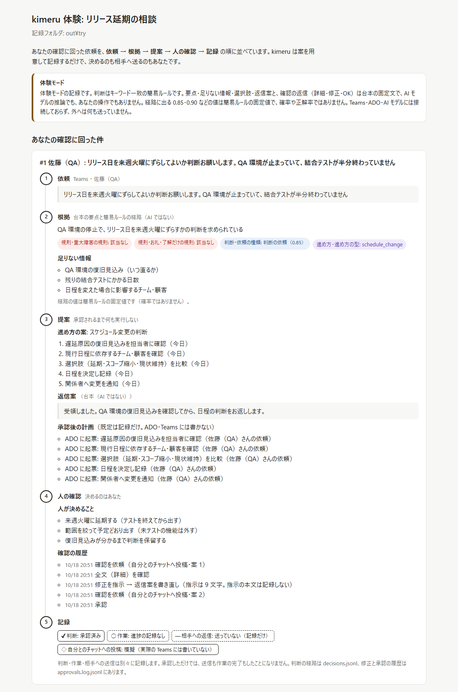
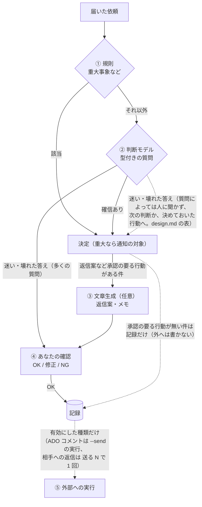

<h1 align="center">kimeru</h1>

<p align="center"><sub>kimeru（「決める」。リポジトリ名は pm-decision・<a href="docs/naming.md">名前について</a>） — approval-first decision drafts for PMs on Windows and Teams</sub></p>

<p align="center">
  <b>Teams・Azure DevOps（ADO）・監視アラート・議事録に散らばる依頼を毎回開き、<br>
  足りない情報を洗い出して返信を一から書いている PM のためのツールです。</b><br>
  依頼を 1 件ずつ読み、「足りない情報・対応の進め方・返信案」をそろえて、あなたの承認を待ちます（足りない情報と返信案の文面は、文章生成 AI を設定したときに書かれます）。<br>
  Windows と Teams で働く PM・開発リーダー向け。決めるのも、相手へ送るのもあなたです。<br>
  初期設定はキーワードによる簡易判定です。確認待ちが届いたことは PC の通知で知らせます。既定ではスマホには通知されません（件数と番号だけを届ける設定はありますが、実際の端末ではまだ確かめていません）。<br>
  承認した返信案は、あなたがコピーして相手に送ります（既定では kimeru は送りません）。
</p>

<p align="center">
  <a href="https://github.com/awano27/pm-decision/actions/workflows/ci.yml"></a>
  
  
  
  
</p>

<p align="center">
  <a href="#-実際の画面">実際の画面</a> ·
  <a href="#-まず動かす">まず動かす</a> ·
  <a href="#-使う前と後">使う前と後</a> ·
  <a href="#-しくみ">しくみ</a> ·
  <a href="#-検証の結果といまの制約">検証と制約</a> ·
  <a href="#-ドキュメント">ドキュメント</a>
</p>

---

| 届くもの（入力） | kimeru が用意するもの（出力） | あなたが決めること |
|---|---|---|
| 「リリース日を来週火曜にずらしてよいか判断お願いします。QA 環境が止まっていて…」（Teams の 1 対 1 チャット） | 判断を求める依頼だと見分け、進め方の案（復旧見込みの確認 → 影響の確認 → 選択肢の比較 → 決定 → 通知）と返信案を用意する。返信は送らない（writer を設定すると、返信案はあなたの承認待ちになる） | 延期するか・範囲を絞るか、返信を送るか |
| 「checkout-api の 5xx が 10 分間 23%、顧客が支払えない」（監視アラート Sev1。英語の原文の要約） | 重大事象の規則で、モデルの答えによらず障害として扱う。障害対応の手順・当番の呼び出し・関係者への投稿・起票 6 件を計画として記録し、通知の対象にする（外へは書かない。手順の型は判断モデルが選ぶ） | 実際の連絡と障害対応 |
| 「ログ基盤を見直す」（議事録の 1 行。担当・期限なし） | 決定・タスク・リスクのどれか決めきれない行として、確認待ちにする | 担当と期限を決める |

この表の出力は、`try` と `demo`（簡易判定）で確かめたものです。足りない情報・選択肢・返信案の文面は、文章生成 AI（writer）を設定したときに相談の文面から書かれます。未設定なら、進め方の案と定型の返信文だけです。ADO のチケットや会議後の宿題などの利用例は [使い方の詳細](docs/usage.md#-利用例とできること) にあります。

2026-10-15 に公開 main と v1.1.0 のソース ZIP を取得し、Python 3.11・追加パッケージなし・通信を禁止した環境で、9 件のデモ、1 件のサンプル、HTML 生成、作業一覧、要件案の Markdown / JSON 保存を確認しました。Teams・ADO・実モデルとの連携や、すべての Windows PC での動作を確認した結果ではありません。

## 🖼 実際の画面

`python -m kimeru try` を実行して作られたレポートです（架空の相談 1 件。画像は加工していません）。1 件の依頼について、**依頼 → 根拠 → 提案 → 人の確認 → 記録** を 1 画面で追えます。

<p align="center"></p>

- 記録の欄は、**判断（承認済みか）・作業（終わったか）・相手への返信（送ったか）・自分とのチャットへの投稿（模擬か、届いたか）** を別々に表示します。承認しても、送信や作業の完了にはなりません。
- 完成例の HTML: [docs/sample/try-report.html](docs/sample/try-report.html)（GitHub 上ではソースとして表示されます。Raw からダウンロードしてブラウザで開くと、インストール前に同じ画面を操作できます）。スマホ幅（375px）の表示は [こちらの画像](assets/readme/try-report-mobile.png)。

自分とのチャットには、次の短い投稿として届きます（`try` の出力から抜粋）。

```text
[kimeru #1] 佐藤（QA）さん: リリース日を来週火曜にずらしてよいか判断お願いします。QA…
→ 佐藤さんに QA 環境の復旧見込みを聞く
案: 受領しました。QA 環境の復旧見込みを確認し、本日 15 時までに日程の判断をお返しします。
⚠ 元の材料に無い日付・数値あり（詳細 1）
OK 1 / NG 1 / 修正 1 <点> / 詳細 1
```

⚠ は、相談の文面に無い「15 時」を返信案が約束していることを示す印です（実際のチェックの結果）。体験では `修正 1 時刻は約束せず短く` と返して書き直させ、`OK 1` で承認します。

---

## 🚀 まず動かす

**必要なもの: Python 3.10 以上だけ。** 追加のパッケージ、アカウント、API キー、Teams、Azure DevOps は要りません（体験は Windows で確かめ、Linux は CI の試験で確かめています。macOS は未確認です）。

```powershell
git clone https://github.com/awano27/pm-decision.git kimeru
cd kimeru
python -m kimeru try
```

Git が無ければ [Code → Download ZIP](https://github.com/awano27/pm-decision) で取得して展開し、`README.md` と `kimeru` フォルダが並ぶ場所で `python -m kimeru try` を実行します。Windows では `try.cmd` をダブルクリックしても同じで、終わるとレポートをブラウザで開く作りです（Python が無いときは入れ方を表示します。ダブルクリックそのものの確認はまだで、中身を PowerShell から実行して確かめています）。clone しない入れ方もあります: `pip install git+https://github.com/awano27/pm-decision` または `uv tool install git+https://github.com/awano27/pm-decision` で入れると、`kimeru demo` と `kimeru try` がそのまま動きます（判断グラフ・進め方の型・デモの台本・Teams 用の PowerShell は同梱され、インストール先の `share/kimeru` から探します）。

> ルートにあるほかの .cmd ファイルは体験用ではありません。START.cmd と run-check.cmd は管理された PC での実機確認用で、Teams の起動や、確認を尋ねたうえでの自分とのチャットへの投稿・Azure のサインインを行います。run-auto-check.cmd は送信もサインインもしませんが、動いている Teams の画面を読みます。build-kev-bundle.cmd は開発 PC で Kev の持ち込み用フォルダを作ります（約 10GB を取得する前に確認します）。体験に使うのは try.cmd だけです。

> **体験モードの約束**: この PC にある kimeru の設定ファイル・環境変数の設定・API キーは、体験の処理には使いません（終わると元に戻します）。AI モデル・外部 CLI・Teams・Azure DevOps には接続しません。Teams は模擬、判断は簡易判定、文面は台本に固定したうえで、処理中は Python からのプロセスの起動（`subprocess`・`os.system` など）とネットワーク接続（`socket`）を止めています。書き込むのは `out\try` と、終わると消す一時フォルダだけです。通常の記録フォルダ（`out` など）には書かず、記録を書くほかのコマンド（`run`・`daily`・`work` など）は `out\try` では止まります（`report` は体験のページを作り直し、`demo --fresh` は既知の記録を退避してデモのフォルダに戻します。[回帰テスト](tests/test_try.py)・[しくみ](docs/design.md#7-体験モードpython--m-kimeru-tryの隔離)）。

**目安の時間**: Python があれば 3 分以内を目標にしています。作者の環境での実測は、clone が 1.7〜1.8 秒、`try` が 1.0〜1.7 秒でした（回線と PC で変わります。初めての人が README を読み始めてから結果を見るまでの時間は、まだ測っていません。[計測の記録](docs/try-verification.md)）。最後に `out\try\report.html` の場所が出るので、ブラウザで開きます。

**Python が無い場合**: Windows なら `winget install Python.Python.3.12`（または [python.org](https://www.python.org/downloads/) のインストーラーで「Add python.exe to PATH」に印）を実行し、PowerShell を開き直してから `python --version` で 3.10 以上と出ることを確かめます。会社の PC で入れられない場合は [管理された PC での導入](docs/managed-environments.md) を参照してください。

### 体験で起きること

`try` は「リリース延期の相談が届く → 不足情報を整理 → 対応案と返信案を確認 → 修正 → 承認 → 判断の記録を見る」を、1 件の架空の相談で順に表示します。

- **判断はキーワード一致の簡易ルールです。** 「判断お願いします」などの語で種類を決めているだけで、AI の推論ではありません。経路に出る 0.85 などの値は固定値で、確率ではありません。
- **要点・返信案・足りない情報・選択肢・次の一手・作業項目の説明と、あなたの返信（`詳細 1`・`修正 1 …`・`OK 1`）は台本の固定文です**（[examples/try_release_delay.json](examples/try_release_delay.json)）。⚠ の検査、承認待ちの扱い、修正・承認の記録は本物の処理です。
- **AI モデルを接続した場合**: 種類の判断は判断モデル（Kev または Jev）が型付きの質問（答えが「はい/いいえ」「選択肢」「段階」のどれかに決まっている質問）に答えて行い、返信案と足りない情報は文章生成 AI（writer）が相談の文面から書きます。文面は今回と同じく承認を待ちます。
- 体験の承認は記録だけです。実際の送信や本番での承認にはなりません。

### もう少し見る: PM の 1 日（9 件）

Teams・アラート・ADO・議事録の 9 件を、規則と簡易判定で順に処理するデモです。デモ内の Teams は模擬で、実際の Teams や ADO には書き込みません。

> `demo` は `try` と違い、この PC の writer の設定を使います。writer を設定した PC では、返信案の材料がその writer の提供元へ送られます。設定がある PC では `try` を使ってください。

```powershell
python -m kimeru --backend stub --out out/demo demo --pace 0
```

`demo` は非空の出力先では、モデルの準備や記録の変更前に止まります。繰り返すときは新しい `--out` を指定してください。明示的な `--fresh` は既知の記録ファイルだけを `before-demo-<日時>` へ退避します。再生（`--replay`）も空の出力先を使います。

`demo` の最後に、こう出ます。

```text
=== まとめ
    判断 9 件: 自動で決定 8 / 確信が低く安全側で決定 0 / 人の確認 1
    うち規則（安全網）で即決定 3 件、モデルの判断 17 回・合計 0.0 秒
    記録: out\demo\decisions.jsonl
    レポート: out\demo\report.html
```

結果は `out/demo/report.html` に出ます。件数は同梱の台本に対する結果で、業務での精度ではありません。1 件の JSON だけを試すコマンドは [使い方の詳細](docs/usage.md#-利用例とできること) にあります。

自分の Teams で 1 回動かすまでの順番は [最初の 30 分](docs/quickstart.md) に、毎日の使い方・承認の返信・止め方・困ったときは [使い方の詳細](docs/usage.md) にあります。

---

## 🔁 使う前と後

| | 使う前 | kimeru を使うと（Teams 連携・判断モデル・writer を設定したとき） |
|---|---|---|
| 依頼を読む | Teams・ADO・アラート・議事録を、それぞれ開いて読む | 届いた順に読まれ、確認が要る件だけが自分とのチャットに短い投稿で届く |
| 何を聞くか考える | 原文から、足りない情報を自分で洗い出す | 足りない情報と選択肢が並んだ状態から始める（`詳細 N` で全文） |
| 返信を書く | 一から書く | 返信案を `OK N`・`修正 N <指示>`・`NG N` で返す |
| 決めたことを残す | メモや記憶に頼る | 判断の経路・修正・承認・作業の進捗が別々にファイルに残る |

**時間がどれだけ減るか、下書きがどれだけ使われるかは、まだ測っていません。** 測り方は [1 週間の試し方](docs/trial-week.md) にあります。

---

## 🧠 しくみ

**規則 → 判断モデル → 文章生成 → あなたの承認 → （有効にした種類だけ）実行**の順に、役割を分けています。4 種類の入力ごとの判断ポイントと、進め方の型（9 種類）は JSON で定義し、チーム向けに追加できます。



| 設計判断 | 理由 | 実装と試験 |
|---|---|---|
| 規則を判断モデルの前に置く | 障害のような見逃せない件を、モデルの答えに左右させない | [graph.py](kimeru/graph.py) の `severe_hit`・`guard_hit` / [test_severe_guards.py](tests/test_severe_guards.py) |
| 判断モデルは文章を書かず、型付きの答え（はい/いいえ・選択肢・段階）だけ返す | 経路をしきい値で決め、迷ったら人へ回すか、害の少ない行動で決められる | [graph.py](kimeru/graph.py) の `route` / [test_kimeru.py](tests/test_kimeru.py) の `test_low_confidence_choice_goes_to_human` |
| 文章は writer が書き、承認まで外に出ない | 生成文の誤り・作り話を人が止められる | [cli.py](kimeru/cli.py) の `_draft` / [test_writer.py](tests/test_writer.py) |
| 承認と実行を分ける | OK は記録だけ。実行は設定で有効にした種類だけで、ADO コメント・承認した優先度変更は OK のあとの `--send` の実行で、相手への返信はさらに `送る N` で 1 回 | [execute.py](kimeru/execute.py) / [test_execute_safety.py](tests/test_execute_safety.py) |
| 結果不明の送信は自動で送り直さない | 二重送信より「本人が確認する」を選ぶ | [notify.py](kimeru/notify.py) の `_delivery_unknown` / [test_delivery_attempts.py](tests/test_delivery_attempts.py) |

詳しい説明・図・未実装の課題は [設計と安全のしくみ](docs/design.md) にあります。

**データの行き先（要点）**: 既定では判断はこの PC の中で行い、記録は `--out` のフォルダに残ります（判断の記録に残る元のメッセージは 120 文字まで。取り込んだ原本の全文は `daily` が 7 日で削除）。PC の外へ出るのは次のときだけです: Jev（TypeSafe のクラウド）を選んだとき、writer を設定したとき、Kev のリモート接続を明示許可したとき、スマホ通知（件数と番号だけ）を設定したとき、`--send` で自分とのチャットへ投稿するとき、ADO コメントまたは優先度変更の実行を有効にして承認したとき、相手への返信の実行を有効にして承認したあと `送る N` と返したとき。詳細は [使い方の詳細](docs/usage.md#-データの行き先) と [SECURITY.md](SECURITY.md)。

Kev をこの PC で動かす場合の準備は [Kev の持ち込み用フォルダ](docs/kev-bundle.md) にあります。開発 PC では `build-kev-bundle.cmd` で作れます（前提は git と uv、ネットにつながる PC。Kev のメモリは bf16 で約 10GB、fp32 で約 14GB。bf16・fp32 は計算の精度で、fp32 のほうがメモリを使います）。

---

## 🔬 検証の結果といまの制約

**業務での有効性を検証している段階です。** Teams・ADO との連携には作者の環境での確認記録がありますが、画面構成や組織の設定によって動作は変わります。次の 4 つは別のものとして扱っています。

| 種類 | 結果 | 何を示し、何を示さないか |
|---|---|---|
| テスト | CI（Windows の Python 3.10〜3.12、Linux の 3.12）で全件合格が必須。体験モードの隔離・承認前に実行しないこと・入力中の指示・重大事象・情報不足・判断モデル停止の回帰テストを含む | コードが仕様どおりに動くこと。判断の正しさではない |
| 模擬データ（モデルなし） | ラベルどおりに答えたとき架空の 147 件がどの経路に進むかを `eval/golden.json` に固定し、変わると試験が落ちる | 規則とグラフの配線。モデルの精度ではない |
| 実モデル（Kev-4B）・架空データ | 開発用 99 件: 正しい 66・人へ 21・安全側 10・誤り 2・重大な取りこぼし 0。検証用 48 件: 36・9・0・3・0（CPU fp32、2026-10-13。安全側 = 迷ったので害の少ない行動にした件） | 作者が作った架空のイベントでの結果。採点するのはラベルを付けた判断だけです（ラベルの無い質問は、モデル自身の答えを正解の経路に使う）。**検証用 48 件も質問文の選定と重大事象のガード（重大度とモデルの評価が食い違ったら人へ回す仕掛け）の設計に使ったため、この 147 件について、開発に使っていないデータでの評価はまだありません**（未使用と記録したのは要件の検討の 10 件だけで、作った日に 1 回測っただけです。[評価資料](docs/evaluation.md#評価データの来歴)） |
| 実業務 | まだありません | 判断精度・時間短縮・下書き採用率・承認までの時間は未測定 |

判断の速さは、作者の開発 PC の CPU（fp32）で 1 件平均 10.7 秒・最大 39 秒でした（管理された PC の fp32 では 1 件約 45 秒〜1 分という観察がありますが、件数を決めた計測ではありません）。判断モデルの確信度は、人へ回すかを決めるしきい値に使う値で、正解の確率ではありません。

| 状態 | 内容 |
|---|---|
| ✅ **実装済み** | 4 種類の入力の判断 / 手順・返信案 / 承認・修正・保留 / 作業進捗 / 要件ドラフト / HTML レポート。モデルなしの体験とデモで流れを試せる |
| 🖥 **作者の環境で確認済み**（あなたの環境では未確認） | Teams のチャット一覧の読み取りと自分とのチャットの読み書き / 承認の流れ（OK・NG・修正・二重処理の防止）/ Kev と Jev による判断 / Copilot による下書き / ADO の取り込み / PC の通知 / `m365`（手動貼り付け）（[動作確認の状況](docs/evaluation.md#動作確認の状況)） |
| 🔬 **テストのみ、または作者の環境での確認記録が無い** | 監視アラートの取り込み / Claude・Grok の下書き / 相手への返信の送信（`送る N`）/ スマホへの通知 / ADO コメント・優先度変更の実行 / 全文読み取り（`read_full`）/ 定期実行 / `停止`・`再開`・`休み` / 約束・返事待ち・前例・差分の朝まとめなどの opt-in 機能（どれも既定では無効） |
| 🧪 **実験的** | `m365-auto`（Teams 内の Microsoft 365 Copilot の画面操作。画面の作りに依存し、失敗すると 30 分休んで手動の依頼文に切り替わる） |
| ⛔ **現在は使えない** | Codex による AI 下書き。選んでも定型文にフォールバックする |
| ⏳ **これから** | 開発に使っていないデータでの評価 / 実データでの評価 / 初めての人による体験の確認 / スマホへの通知の実機確認 / `m365-auto` を複数環境で確認して実験的から外す |

今回の統合では、上の実モデルの成績や作者の環境での過去の確認を再実施した結果として扱いません。実データ評価・スマホ受信・Teams 操作性・複数環境の `m365-auto` 確認は **NOT_RUN** です。実装と隔離したローカル検証の記録は [統合作業の計画](docs/tasks/integration-2026-10-23/PLAN.md) に分けて記録します。

- **自動運転は、Teams の画面切り替えの問題を実機で確認するまで使わないでください。** 通常の承認読み取りは操作前の画面を保存し、利用者操作・復帰失敗・ロック競合を検出した回は延期します。延期を「返信なし」や承認として扱いません。合成 UI の成功だけで、この注意は外しません。
- **実データ評価の準備**: 既存の `review` が保存する `fixtures_user.jsonl` から、`dataset anonymize` → 人の内容確認 → `mark-reviewed` → `split` / `check` へ進めます。匿名化候補は元ファイルを変更せずに作り、秘密や固有情報が残り得るため自動で匿名化済みとは保証しません。調整用・評価用の分割と来歴を記録します（[評価の手順](docs/evaluation.md)、[評価入力と採点](eval/README.md)）。Jev の評価結果の非公開・共有制限は継続します。
- **スマホの実機確認**: 通知経路の受理と端末での受信を分け、経路ごとの challenge を本人が確認します。`onboarding device-check` で日時・経路・受信確認・未確認範囲を確認でき、旧形式の経路不明な確認を全経路の成功とは扱いません（[通知の手順](docs/push-notification.md)）。
- **`m365-auto` は実験的のままです。** 入力先・フォーカス・本文一致・送信先が一意であることを確認し、失敗後 30 分の休止と手動 `m365` への切り替えを維持します。合成 UI と実際の複数環境の結果を分けます。
- **外部実行は種類ごとの opt-in**: 公開 main の `teams.reply` / `送る N` を維持し、今回追加する `ado.update` は承認済みの優先度（1〜4）変更だけです。対象・値・改訂が変われば再承認し、結果不明は成功にせず自動再送しません。優先度を変更しても案件全体の作業完了にはなりません（[ADO 優先度変更](docs/execute-ado-update.md)）。

**向いている使い方**: Windows 10/11 と Teams で働く PM・リーダーが、決める前に材料と選択肢を並べてほしいとき。管理者権限は要りません。

**向かない使い方**: Mac・Linux での Teams 連携（Teams の読み取りは Windows の画面操作）、Slack や Google Chat が中心の職場、返信や起票まで全自動にしたい場合（kimeru は承認制で、既定では記録だけ）、判断そのものを LLM に任せたい場合。Teams の画面を自動操作するので、組織で認められているかを先に確かめてください。

---

## 📚 ドキュメント

| 知りたいこと | ドキュメント |
|---|---|
| デモから自分の Teams で 1 回動かすまで | [最初の 30 分](docs/quickstart.md) |
| ソース ZIP で動く範囲・利用例・判断モデル（Kev/Jev）の準備・毎日の使い方・承認の返信・止め方・困ったとき・writer・データの行き先 | [使い方の詳細](docs/usage.md) |
| 設計の理由・安全のしくみ・未実装の課題 | [設計と安全のしくみ](docs/design.md) |
| 体験の手順を新しい環境で確かめた記録 | [体験の検証記録](docs/try-verification.md) |
| 管理された PC へ持ち込む・実機で確認する | [導入](docs/managed-environments.md) / [実機確認](docs/managed-pc-check.md) |
| コマンド・設定・入力形式・グラフを書く | [リファレンス](docs/reference.md) |
| 判断モデルを持ち込む | [Kev の持ち込み用フォルダ](docs/kev-bundle.md) |
| 下書き用の LLM を選ぶ | [writer](docs/writers.md) |
| スマホ通知・ADO 実行を有効にする | [push 通知](docs/push-notification.md) / [ADO コメント](docs/execute-ado-comment.md) / [優先度変更](docs/execute-ado-update.md) |
| 承認した返信を相手に送る（`送る N`）を有効にする | [相手への返信の送信](docs/execute-teams-reply.md) |
| 要件ドラフトを作る・議事録を取り込む | [要件ドラフト](docs/requirements.md) / [議事録の形式](docs/minutes-format.md) |
| 精度・評価データの来歴・動作確認 | [評価と既知の課題](docs/evaluation.md) / [eval/README.md](eval/README.md) |
| 効果を測る | [初回の観察](docs/first-run-observation.md) / [1 週間の試行](docs/trial-week.md) |
| これまでとこれから | [ロードマップ](docs/usage.md#-ロードマップ) / [変更履歴](CHANGELOG.md) |
| 安全・開発 | [セキュリティ](SECURITY.md) / [貢献](CONTRIBUTING.md) |

Issue と PR を歓迎します。「利用結果の報告」「動作環境の報告」「不具合」の Issue 様式があります。テストの回し方は [CONTRIBUTING.md](CONTRIBUTING.md)。

## 📄 ライセンス

MIT（[LICENSE](LICENSE)）。Kev と Qwen3.5 のモデルはそれぞれ Apache-2.0。
